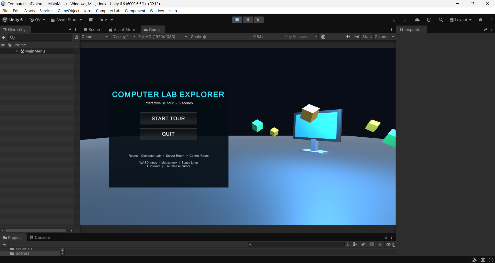
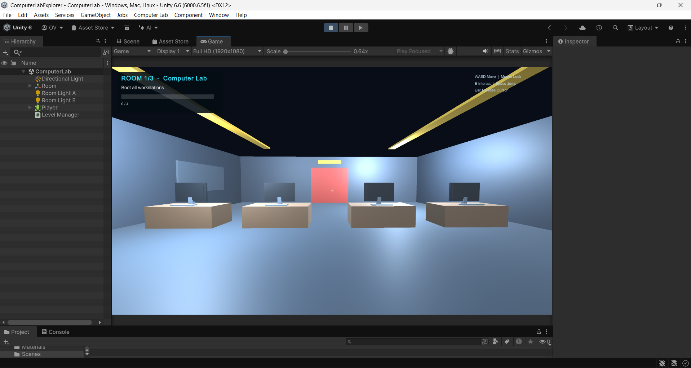
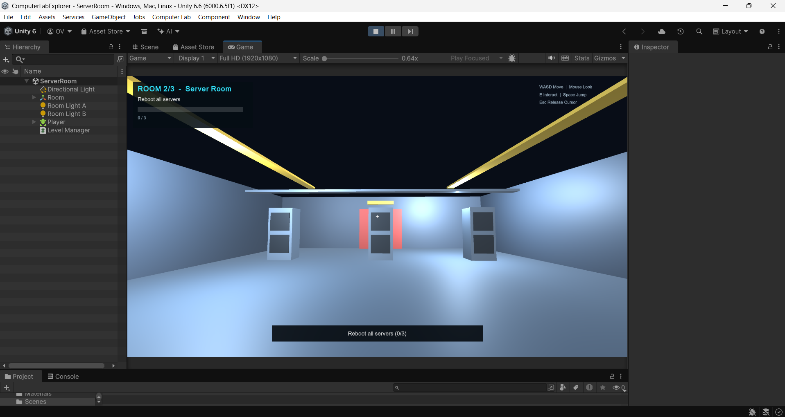
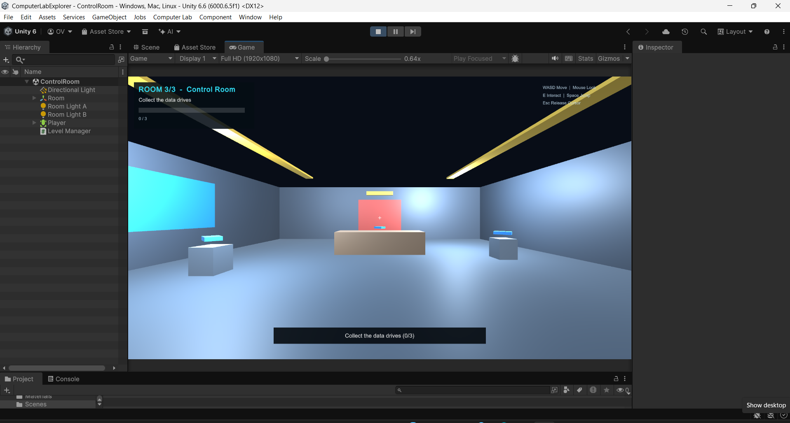
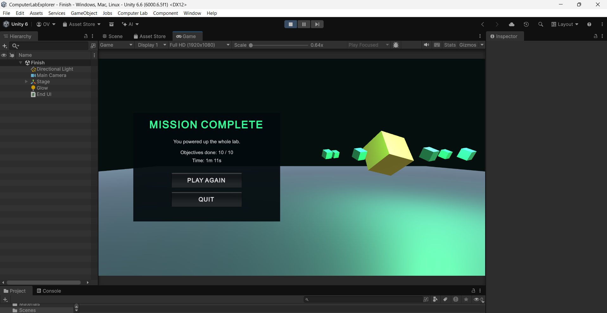

# Computer Lab Explorer

An interactive first-person 3D tour of a computer lab, built in **Unity 6 (6000.6.5f1)**.
The player walks through three rooms, completes an objective in each, and is moved between
scenes at runtime with a fade transition.

> Mini project for **CSDOL7021 - User Experience Design with VR Lab (Experiment 9)**,
---

## Screenshots

| Main Menu | Computer Lab | Server Room |
|:--:|:--:|:--:|
|  |  |  |

| Control Room | Finish |
|:--:|:--:|
|  |  |

---

## Features

- **5 scenes switched dynamically at runtime** with a fade-to-black transition
- **First-person controller**: walk, look, jump (CharacterController)
- **Object interaction** via a raycast from the camera: press **E** on objects within reach
- **Animation**: pulsing screens, "pop" feedback on activation, spinning and bobbing pickups,
  sliding exit door, rotating menu and finish-screen props
- **UI**: main menu, in-game HUD (room number, objective, progress bar), contextual
  interaction prompts, crosshair, message banners and an end screen with score and time
- **Input-system agnostic**: works with Input Manager (Old), Input System (New) or Both
- **No external assets or packages**: every object is built from Unity primitives

---

## Scenes and Flow

```
MainMenu  ->  ComputerLab  ->  ServerRoom  ->  ControlRoom  ->  Finish  ->  MainMenu
```

| # | Scene | Objective | Interaction |
|---|-------|-----------|-------------|
| 1 | `MainMenu` | Start the tour | Start / Quit buttons |
| 2 | `ComputerLab` | Boot all 4 workstations | Press E on each monitor |
| 3 | `ServerRoom` | Reboot all 3 servers | Press E on each rack |
| 4 | `ControlRoom` | Collect 3 data drives | Press E on each drive |
| 5 | `Finish` | View score and time | Play Again / Quit |

When a room's objective is complete, the red exit door turns green. Press **E** on it to open
it and move to the next scene.

---

## Controls

| Key | Action |
|-----|--------|
| `W` `A` `S` `D` | Move |
| Mouse | Look around |
| `Space` | Jump |
| `E` | Interact |
| `Esc` | Release the mouse cursor (click in the Game view to lock it again) |

---

## Getting Started

### Requirements
- Unity Hub
- Unity Editor **6000.6.5f1** (Unity 6.6)

### Run the project
1. Clone or download this repository.
   ```
   git clone https://github.com/Omm13/ComputerLabExplorer.git
   ```
2. In Unity Hub choose **Add > Add project from disk** and select the `ComputerLabExplorer` folder.
3. Open it with Unity **6000.6.5f1**. The first import takes a minute or two.
4. Open `Assets/Scenes/MainMenu.unity` and press **Play**.

If the scenes are missing, use the top menu **Computer Lab > Build All Scenes** to regenerate them.

---

## Project Structure

```
ComputerLabExplorer/
├── Assets/
│   ├── Materials/            Colour materials (generated)
│   ├── Scenes/               MainMenu, ComputerLab, ServerRoom, ControlRoom, Finish
│   └── Scripts/
│       ├── Editor/
│       │   └── LabBuilder.cs     Editor tool that builds the 5 scenes
│       ├── FPSPlayer.cs          Movement, mouse look, interaction raycast
│       ├── GameInput.cs          Input wrapper (Old / New / Both)
│       ├── Interactable.cs       Base class for everything the player can use
│       ├── Device.cs             Workstations and servers (boot, pulse, pop animation)
│       ├── Pickup.cs             Collectible data drives (spin and bob)
│       ├── DoorPortal.cs         Locked / unlocked sliding exit door
│       ├── LevelManager.cs       Objectives, HUD, messages, fade, scene loading
│       ├── MenuUI.cs             Main menu
│       ├── EndUI.cs              Finish screen
│       ├── Spinner.cs            Rotating decorative props
│       └── UiUtil.cs             Shared UI helpers
├── Packages/manifest.json
├── ProjectSettings/
└── README.md
```

---

## How It Works

- **Interaction system.** `FPSPlayer` casts a ray forward from the camera each frame. If it hits an
  object with an `Interactable` component, a prompt is shown and pressing **E** calls its
  `Interact()` method. `Device`, `Pickup` and `DoorPortal` all inherit from `Interactable`.
- **Progress tracking.** Each scene has a `LevelManager` holding the objective text and the number of
  required actions. Devices and pickups call `LevelManager.Add()`. `DoorPortal` stays locked until
  the objective is done.
- **Scene switching.** The door calls `LevelManager.LoadNext()`, which fades the screen to black and
  then loads the next scene with `SceneManager.LoadScene`. Score and time persist between scenes
  in a static `Progress` class.
- **Scene generation.** `LabBuilder` (editor-only) creates all five scenes from primitives and adds them
  to the Build Settings in order.
- **UI.** Built with Unity's immediate-mode GUI (`OnGUI`), which works identically under every
  input setting.

---

## Known Limitations

- No audio or music
- Graphics use basic primitive shapes and flat colours
- UI uses `OnGUI` rather than a Canvas-based system
- Not configured for VR headsets

---

## Tech Stack

Unity 6 (6000.6.5f1) - C# - IMGUI

---